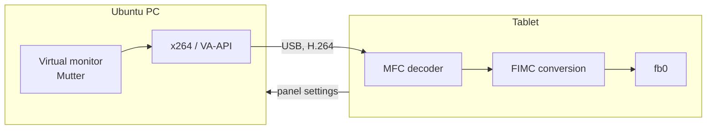

# GT-N8000 External Monitor

Turns a 2012 Samsung Galaxy Note 10.1 (GT-N8000) into a USB external monitor for Ubuntu, at 60 fps and without Android in the way.

Plug in the cable and a new monitor appears on the PC. Unplug it and the monitor goes away, then the tablet powers itself off.

| | |
| --- | --- |
| Resolution | 1280×800, landscape or portrait |
| Frame rate | 58–60 fps with motion |
| Time on the tablet | 10.5 ms decode, 9 ms colour conversion |

The tablet is **only a screen**: touch and pen do not control the PC. Both were tried and dropped.

## Requirements

**Tablet**

- A GT-N8000. Other models are not supported.
- **Root is mandatory**: partitions are read and written through `su` from Android.
- An Android 7.1 ROM. Tested with RR, a LineageOS-based ROM.
- **Tested only with TWRP as recovery.** The menu entry is fixed as `Recovery (TWRP)`: it reboots into whatever is in the RECOVERY partition, but it does not adapt to other recoveries. With a different one the label stays wrong, and that case was never tested. Keep this in mind if you need to restore the tablet.

**PC**

- **Only Ubuntu works out of the box for now.** Tested on one machine with GNOME 46 on Wayland.
- A udev rule may be needed for USB access and automatic start. `host/install.sh` sets it up; see [Troubleshooting](docs/troubleshooting.md#the-monitor-does-not-appear-on-the-pc) to set it by hand.
- Other distributions may work if they have GNOME on Wayland, but they were not tested. Xorg is not supported, and neither is Windows.

## How it works

The PC creates a virtual monitor in GNOME, encodes its screen to H.264 and sends it over USB. On the tablet a small system runs in place of Android: the same kernel, but with a single program, `notedisplayd`, which decodes in hardware and writes straight to the framebuffer. Removing SurfaceFlinger and Java is what cuts the latency.



## On the tablet

A menu appears for 5 seconds at power-on, starting from the most recent choice:

- **External display**: the USB monitor.
- **Android**: the original system, with no extra reboot.
- **Recovery (TWRP)**.

Volume moves the selection and Power confirms, or you can touch an entry.

While the display is running, a touch anywhere or the Power key opens a panel with battery, fps and timings. The panel also sets brightness, by hand or from the light sensor, rotation, the fps limit and the keepalive.

## Guides

| Guide | Contents |
| --- | --- |
| [Installation](docs/installation.md) | backup, building the image, flashing, PC host |
| [Usage](docs/usage.md) | menu, panel, what happens when you plug and unplug the cable |
| [Troubleshooting](docs/troubleshooting.md) | common symptoms and restoring the tablet |
| [Architecture](docs/architecture.md) | threads, video path, why things are the way they are |
| [USB protocol](docs/protocol.md) | packet format |
| [Development](docs/development.md) | test cycle, Samsung kernel pitfalls |
| [Project history](docs/history.md) | what was tried and what worked |

## Layout

```text
tablet/   system on the tablet: notedisplayd, boot menu, /init, flashing tools
host/     Ubuntu program, udev rule, user service
docs/     guides
```

## Warnings

This project rewrites the BOOT partition of a tablet. **Back up first**: the installation guide explains how. It works only on the GT-N8000 and was tested on a single unit.

The repository does not contain the kernel, the Android ramdisk or the MFC firmware: the scripts extract them from your own tablet.

Windows support would need a virtual monitor driver and a new PC program.

## License

GPL-2.0, see [LICENSE](LICENSE). The font comes from the Linux kernel; the headers in `tablet/src/kernel/` are Samsung's, dual-licensed GPL-2.0 or Apache-2.0.
