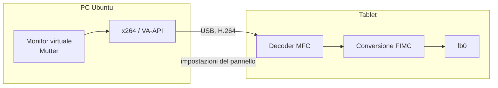

# GT-N8000 External Monitor

Trasforma un Samsung Galaxy Note 10.1 (GT-N8000) del 2012 in un monitor esterno USB per Ubuntu, a 60 fps e senza Android di mezzo.

Colleghi il cavo e sul PC compare un nuovo monitor. Stacchi il cavo e il monitor sparisce, poi il tablet si spegne da solo.

| | |
| --- | --- |
| Risoluzione | 1280×800, orizzontale o verticale |
| Frequenza | 58–60 fps con il movimento |
| Tempi sul tablet | decodifica 10,5 ms, conversione colore 9 ms |
| PC | Ubuntu con GNOME su Wayland |
| Tablet | GT-N8000 con LineageOS/RR 7.1 e root |

Il tablet è **solo uno schermo**: tocco e penna non controllano il PC. Sono stati provati e scartati.

## Come funziona

Il PC crea un monitor virtuale in GNOME, ne codifica lo schermo in H.264 e lo invia via USB. Sul tablet parte un piccolo sistema al posto di Android: lo stesso kernel, ma con un solo programma, `notedisplayd`, che decodifica con l'hardware e scrive direttamente nel framebuffer. Eliminare SurfaceFlinger e Java è ciò che riduce la latenza.



## Sul tablet

All'accensione compare un menu per 5 secondi, che riparte dalla scelta più recente:

- **Display esterno**: il monitor USB.
- **Android**: il sistema originale, senza riavvii aggiuntivi.
- **Recovery (TWRP)**.

Volume sposta la selezione, Accensione conferma, oppure si tocca la voce.

Mentre il display è attivo, un tocco ovunque o il tasto Accensione aprono un pannello con batteria, fps e tempi. Dal pannello si regolano luminosità, rotazione, limite di fps e keepalive.

## Guide

| Guida | Contenuto |
| --- | --- |
| [Installazione](docs/installazione.md) | backup, costruzione dell'immagine, scrittura, host sul PC |
| [Uso](docs/uso.md) | menu, pannello, cosa succede collegando e staccando il cavo |
| [Risoluzione dei problemi](docs/problemi.md) | sintomi comuni e ripristino del tablet |
| [Architettura](docs/architettura.md) | thread, conversione video, perché certe scelte |
| [Protocollo USB](docs/protocollo.md) | formato dei pacchetti |
| [Sviluppo](docs/sviluppo.md) | ciclo di prova, trappole del kernel Samsung |
| [Storia del progetto](docs/storia.md) | cosa è stato provato, cosa ha funzionato |

## Struttura

```text
tablet/   sistema sul tablet: notedisplayd, menu di avvio, /init, strumenti di scrittura
host/     programma per Ubuntu, regola udev, servizio utente
docs/     guide
```

## Avvertenze

Il progetto riscrive la partizione BOOT di un tablet. **Fai prima il backup**: la guida di installazione spiega come. Funziona solo sul GT-N8000 ed è stato provato su un unico esemplare.

La repo non contiene il kernel, il ramdisk di Android né il firmware dell'MFC: gli script li estraggono dal tuo tablet.

Il supporto Windows non esiste: richiederebbe un driver per il monitor virtuale e un nuovo programma lato PC.

## Licenza

GPL-2.0, vedi [LICENSE](LICENSE). Il font viene dal kernel Linux; gli header in `tablet/src/kernel/` sono di Samsung, con doppia licenza GPL-2.0 o Apache-2.0.
