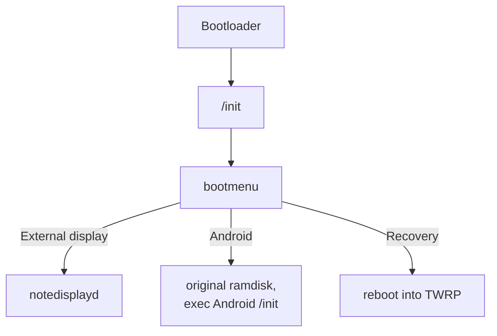
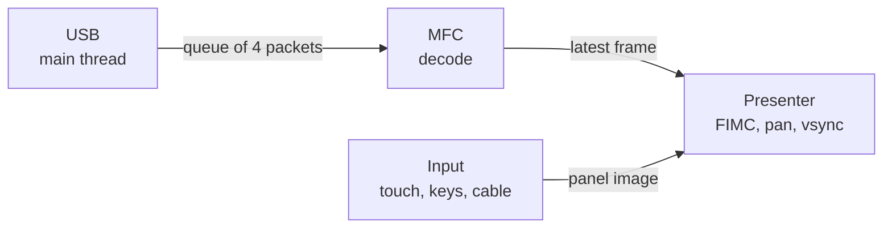

# Architecture

The tablet boots the same Samsung 3.0 kernel as Android, with its own initramfs. A single program does everything: no SurfaceFlinger, no Java.

## notedisplayd threads

- **USB:** reads packets from `/dev/usb_accessory`. When the queue is full it slows the host down instead of building up delay.
- **Decode:** must see every frame, because P frames depend on the previous ones.
- **Presenter:** keeps only the most recent frame. It is the only place where frames can be skipped.
- **Input:** does the slow work, such as sysfs and text drawing, so the presenter stays fast.

## Path of a frame

1. The MFC decodes into its buffers: 64×32 tiled NV12, with zero decoder delay.
2. FIMC3 (`/dev/video3`, the same one Android uses) reads by physical address, with no copies, and writes RGB32 to the hidden page of `fb0`, rotating if needed.
3. If the panel is open, the CPU copies it on top.
4. `FBIOPAN_DISPLAY` swaps the pages, then the thread waits for vsync before touching the other page.

The frame being converted is a reference for the next one: the decoder waits for the FIMC before it can reuse that buffer.

## Virtual monitor

The host uses Mutter's ScreenCast API, the same as GNOME remote desktop, with a virtual monitor. Two details matter for smoothness:

- With `max-framerate=60` Mutter skips refreshes and stops at 33–47 fps. The host asks for twice that and applies the real limit in `on_captured`.
- Without that limit frames arrive faster than the decoder can handle, and the queue turns into visible delay.

Changing orientation recreates the virtual monitor without dropping USB: the tablet receives a new configuration and rebuilds the decoder.

## Where data is kept

The menu choice is in the last block of BOOT, as the text `NDBOOT=0` or `NDBOOT=1`: past the end of the image, where nothing else writes and the bootloader does not read. Android's cache partition is not suitable, because TWRP or an update can wipe it. `mkbootimg.py` refuses images that would reach that block.

## Safety

If the cable is removed, the tablet powers off after 10 seconds. If the cable state cannot be read the tablet treats it as connected, so a read error does not power it off. A process in `/init` reboots the tablet if `notedisplayd` dies.
