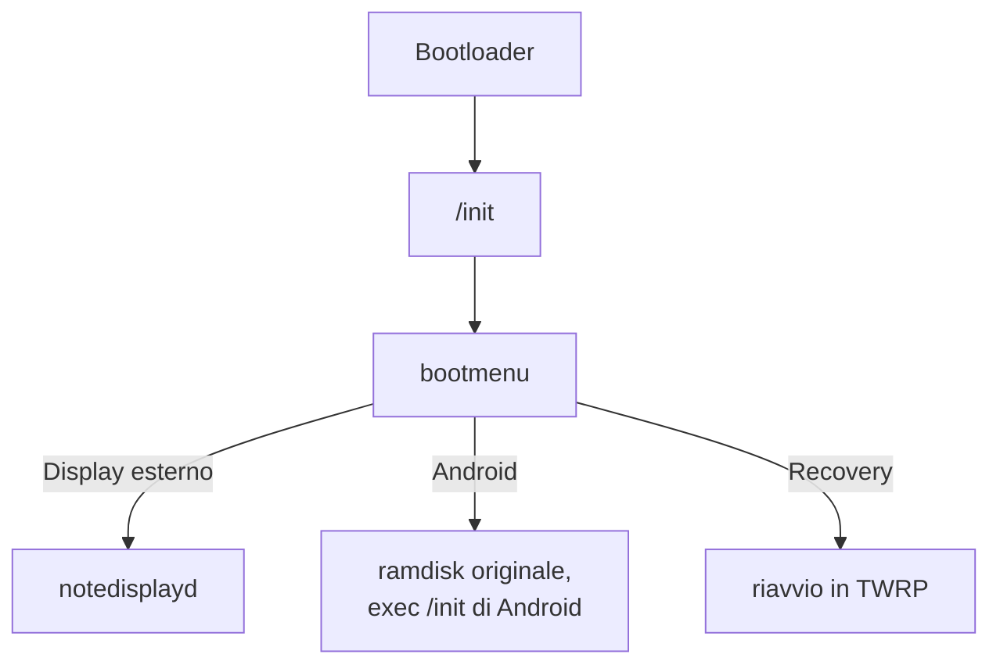
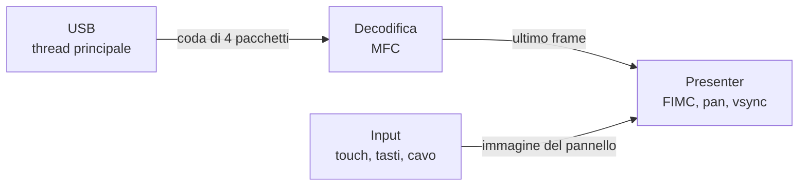

# Architettura

Il tablet avvia lo stesso kernel Samsung 3.0 di Android, con un initramfs proprio. Un solo programma fa tutto: niente SurfaceFlinger, niente Java.

## Thread di notedisplayd

- **USB:** legge i pacchetti da `/dev/usb_accessory`. Se la coda è piena rallenta l'host invece di accumulare ritardo.
- **Decodifica:** deve vedere tutti i frame, perché i frame P dipendono dai precedenti.
- **Presenter:** tiene solo il frame più recente. È l'unico punto in cui si possono saltare frame.
- **Input:** fa il lavoro lento, come sysfs e disegno del testo, così il presenter resta veloce.

## Percorso di un frame

1. L'MFC decodifica nei suoi buffer: NV12 a tile 64×32, ritardo del decoder zero.
2. La FIMC3 (`/dev/video3`, la stessa di Android) legge per indirizzo fisico, senza copie, e scrive RGB32 nella pagina nascosta di `fb0`, ruotando se serve.
3. Se il pannello è aperto, la CPU lo copia sopra.
4. `FBIOPAN_DISPLAY` scambia le pagine, poi il thread attende il vsync prima di toccare l'altra pagina.

Il frame in conversione fa da riferimento per il successivo: il decoder aspetta la FIMC prima di poter riusare quel buffer.

## Monitor virtuale

L'host usa l'API ScreenCast di Mutter, la stessa del desktop remoto di GNOME, con un monitor virtuale. Due dettagli pesano sulla fluidità:

- Con `max-framerate=60` Mutter salta dei refresh e si ferma a 33–47 fps. L'host chiede il doppio e applica il limite vero in `on_captured`.
- Senza quel limite i frame arrivano più in fretta di quanto il decoder regga, e la coda diventa ritardo visibile.

Il cambio di orientamento ricrea il monitor virtuale senza staccare la USB: il tablet riceve una nuova configurazione e rifà il decoder.

## Dove si conservano i dati

La scelta del menu è nell'ultimo blocco di BOOT, come testo `NDBOOT=0` o `NDBOOT=1`: oltre la fine dell'immagine, dove non scrive nessun altro e il bootloader non legge. La partizione cache di Android non è adatta, perché TWRP o un aggiornamento possono svuotarla. `mkbootimg.py` rifiuta immagini che arriverebbero a quel blocco.

## Sicurezza

Se il cavo si stacca, il tablet si spegne dopo 10 secondi. Se lo stato del cavo non si può leggere, il tablet lo considera collegato, così un errore di lettura non lo spegne. Un processo in `/init` riavvia il tablet se `notedisplayd` muore.
